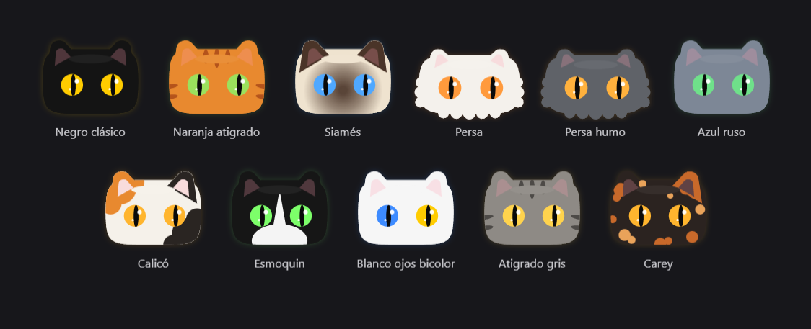
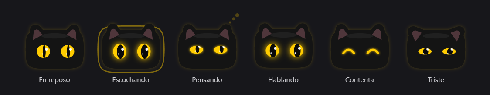
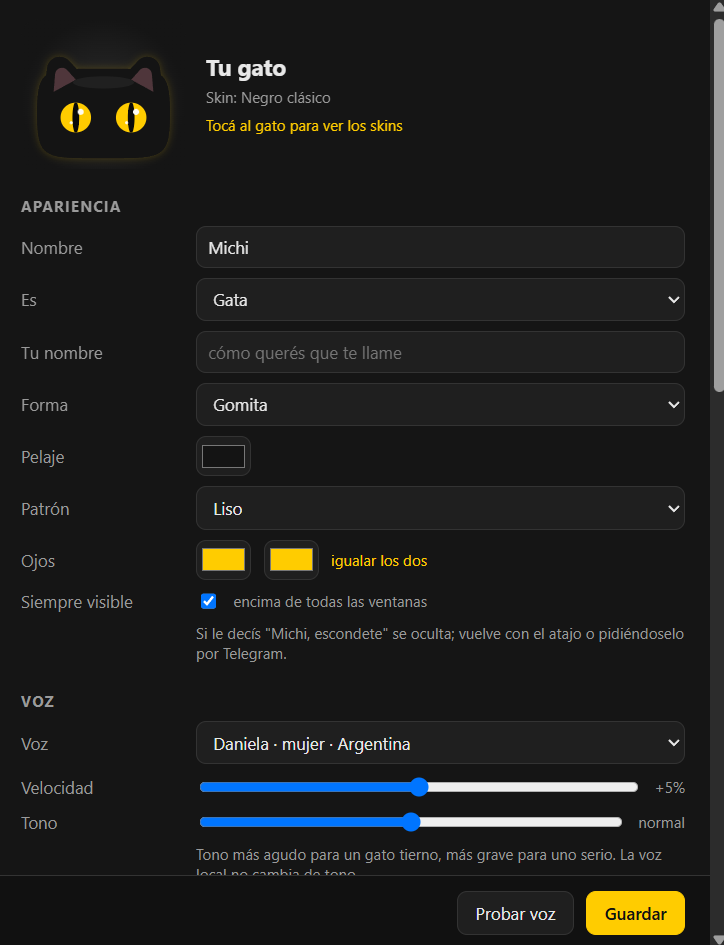

# Michi: asistente personal de voz con IA para Windows, gratis y en español


**Michi** es un **asistente virtual de escritorio con inteligencia artificial** que vive en tu PC con forma de gata. Le hablás y te contesta **con voz argentina**: abre programas, pone música, busca información actual, lee tus mails, **escribe lo que dictás en cualquier ventana**, se acuerda de lo que le contás y también te atiende **desde el celular por Telegram**. Funciona con herramientas **gratuitas** y responde en uno o dos segundos.



## Contenido

- [¿Qué es Michi?](#qué-es-michi)
- [¿Para qué sirve?](#para-qué-sirve)
- [Funciones](#funciones)
- [Instalación](#instalación)
- [Cómo se usa](#cómo-se-usa)
- [Celular: Michi en Telegram](#celular-michi-en-telegram)
- [Integración con Claude](#integración-con-claude)
- [Personalización: skins y voces](#personalización-skins-y-voces)
- [Privacidad y seguridad](#privacidad-y-seguridad)
- [Limitaciones y sesgos](#limitaciones-y-sesgos)
- [Preguntas frecuentes](#preguntas-frecuentes)
- [Cómo está hecho](#cómo-está-hecho)
- [English summary](#english-summary)

## ¿Qué es Michi?

Michi es un **asistente de voz para Windows en español**, pensado para hablarle como a una persona y no como a una máquina. Es una ventanita transparente con una gata animada que te sigue con la mirada, parpadea, para las orejas cuando te escucha y le brillan los ojos cuando habla. No tiene boca: toda la expresión está en los ojos.

Habla en **español rioplatense** (voseo y tono argentino), con una personalidad cálida y algún que otro remate gatuno. Combina modelos de IA en la nube que tienen plan gratis (**Groq** y **Google Gemini**) con una **voz local** que corre en tu PC, así que no hace falta pagar nada para usarlo todos los días.

## ¿Para qué sirve?

- **Manejar la PC con la voz**: "abrime WhatsApp", "abrí descargas", "poneme música tranquila", "subí el volumen".
- **Escribir sin teclado**: mantenés una tecla, dictás y el texto aparece donde está el cursor (Word, el navegador, WhatsApp Web, un chat, lo que sea).
- **Consultas rápidas con datos actuales**: el dólar, el clima, noticias, resultados, la hora.
- **Mails**: te lee remitente y asunto de los no leídos, y te deja borradores listos en Gmail.
- **Tareas más pesadas**: le pide ayuda a **Claude** para redactar, planificar, explicar o revisar código.
- **Usarlo desde el celular**: le mandás un audio por Telegram y te contesta con una nota de voz.

## Funciones

| Función | Detalle |
|---|---|
| Conversación por voz | Clic en Michi o `Ctrl+Alt+G`, hablás y responde con voz en ~1,5 a 2,5 s |
| Dictado en cualquier app | Mantené **Ctrl derecho**, hablá y soltá: escribe el texto con puntuación |
| Abrir programas y carpetas | Encuentra cualquier programa del menú Inicio por nombre |
| Música y multimedia | Busca y reproduce en YouTube; pausa, siguiente, volumen |
| Búsqueda en internet | Información actual sin claves extra (DuckDuckGo) |
| Gmail | Lee los no leídos y abre borradores; **nunca envía mails solo** |
| Memoria a largo plazo | Recuerda tus gustos, gente y datos importantes aunque reinicies; los podés ver y editar |
| Claude | Le deriva los pedidos complejos y te resume la respuesta en voz |
| Celular por Telegram | Texto o audios desde Android o iPhone, con respuesta en nota de voz |
| 11 skins editables | Forma, pelaje, patrón y color de cada ojo, con vista previa en vivo |
| 26 voces | 4 rioplatenses (Argentina y Uruguay), una local instantánea y más acentos |
| Siempre visible | Queda encima de las ventanas; "Michi, escondete" la oculta |
| Arranque con Windows | Aparece sola al prender la PC (se puede desactivar) |



## Instalación

**Requisitos:** Windows 10 u 11, micrófono y conexión a internet. Python no hace falta tenerlo: el instalador lo baja solo con [uv](https://docs.astral.sh/uv/).

1. Descargá el proyecto: botón verde **Code → Download ZIP** (y descomprimilo), o con git:
   ```bash
   git clone https://github.com/leandrosesto/michi-asistente-personal.git
   ```
2. Hacé doble clic en **`instalar.bat`**. Instala las dependencias y descarga la voz argentina local (~110 MB).
3. Abrí Michi con **`iniciar.bat`**. Aparece abajo a la derecha de la pantalla.
4. Clic derecho sobre Michi → **Configurar**, y cargá tus claves gratuitas:

| Clave | Para qué | Dónde se consigue (gratis) |
|---|---|---|
| **Groq** | Entender tu voz y cerebro principal | [console.groq.com/keys](https://console.groq.com/keys) |
| **Gemini** | Cerebro de respaldo | [aistudio.google.com/apikey](https://aistudio.google.com/apikey) |
| Telegram (opcional) | Usar a Michi desde el celular | Hablale a [@BotFather](https://t.me/BotFather) y mandá `/newbot` |
| Gmail (opcional) | Leer tus mails no leídos | [Contraseña de aplicación](https://myaccount.google.com/apppasswords) (requiere verificación en dos pasos) |
| Anthropic (opcional, de pago) | Respuestas de Claude directo en la voz | [platform.claude.com](https://platform.claude.com/settings/keys) |

Para enviar notas de voz por Telegram hace falta **ffmpeg**: `winget install ffmpeg`.



## Cómo se usa

| Acción | Cómo |
|---|---|
| Hablarle | Clic en Michi o `Ctrl+Alt+G` |
| Dictar texto | Mantener `Ctrl derecho`, hablar y soltar |
| Callarla | Clic mientras habla |
| Moverla | Arrastrarla (recuerda la posición) |
| Menú | Clic derecho: Hablar, Configurar, Salir |
| Esconderla | Decile "Michi, escondete"; vuelve con `Ctrl+Alt+G` |

Ejemplos de cosas para decirle:

- "Abrime Chrome" · "Abrí la carpeta de descargas" · "Abrí el explorador"
- "Poneme Soda Stereo" · "Pausá la música" · "Bajá el volumen"
- "¿A cuánto está el dólar blue?" · "¿Qué hora es?"
- "¿Tengo mails nuevos?" · "Armame un mail para Juan avisando que llego tarde"
- "Acordate de que mi cumpleaños es el 3 de mayo" · "¿Qué sabés de mí?" · "Olvidate de eso"
- "Preguntale a Claude cómo armo una presentación de cinco minutos"

## Celular: Michi en Telegram

Michi incluye un **bot de Telegram** que corre en tu propia PC: no usa servidores, no abre puertos y anda en Android y en iPhone.

1. Creá el bot con [@BotFather](https://t.me/BotFather) y pegá el token en Configurar.
2. Escribile a tu bot: te va a responder con tu *chat id*. Pegalo en Configurar.
3. Desde ese momento **solo te obedece a vos**: mandale texto o audios y te contesta con texto y nota de voz.

La PC tiene que estar prendida para que Michi pueda actuar en ella.

## Integración con Claude

Para lo que pide más cabeza (redactar, planificar, explicar a fondo, código), Michi le pasa el pedido a **Claude**, de Anthropic, y te resume la respuesta en voz. La respuesta completa queda copiada en el portapapeles. Usa el primer camino disponible:

1. **Clave de la API de Anthropic** (de pago): respuesta directa con el SDK oficial.
2. **[Claude Code](https://claude.com/claude-code) instalado**: usa tu plan de Claude, sin clave aparte.
3. **Ninguno de los dos**: abre [claude.ai](https://claude.ai) con tu pedido ya escrito (y copiado, por si hay que pegarlo).

## Personalización: skins y voces

- **Skins:** en Configurar, tocá a Michi para ver la galería. Los 11 skins (negro clásico, naranja atigrado, siamés, persa, persa humo, azul ruso, calicó, esmoquin, blanco con ojos bicolor, atigrado gris y carey) se pueden modificar: forma (Gomita o Persa), pelaje, patrón y el color de **cada ojo** por separado.
- **Voces:** **Daniela** (argentina, corre en tu PC, la más rápida y anda sin internet), **Elena y Tomás** (Argentina), **Valentina y Mateo** (Uruguay), más voces de Chile, México, Colombia, Perú, España y otras. Se ajustan la velocidad y el tono.
- **Personalidad:** nombre, si es gata o gato y cómo te llama a vos.

## Privacidad y seguridad

- **Las claves no se guardan en archivos**: van al Administrador de credenciales de Windows.
- **Tus datos quedan en tu PC**: la configuración (`config.json`) y la memoria (`memoria.json`) son locales y están excluidas del repositorio.
- **Qué sale a internet**: el texto de lo que decís va a Groq o Gemini para responder; el audio se transcribe en Groq. Con la voz Daniela la síntesis de voz es 100 % local.
- **Telegram**: el bot solo responde al chat autorizado e ignora a cualquier otra persona.
- **Mails**: acceso de solo lectura; Michi nunca envía mails por su cuenta.
- **Sin telemetría**: Michi no manda estadísticas de uso a ningún lado.

## Limitaciones y sesgos

Michi usa modelos de inteligencia artificial y hereda sus limitaciones. Conviene tenerlas presentes:

- **Puede equivocarse o inventar.** Los modelos de lenguaje a veces afirman cosas falsas con seguridad. Para datos actuales Michi busca en internet antes de contestar, pero verificá lo importante (salud, plata, temas legales).
- **Sesgos de los modelos.** Los modelos se entrenan con textos de internet y pueden reproducir estereotipos culturales, de género o regionales, y suelen conocer mejor el contexto de EE. UU. y Europa que el de Argentina o Latinoamérica.
- **Sesgos del reconocimiento de voz.** Whisper funciona mejor con acentos y pronunciaciones más representados en sus datos; con ruido, acentos marcados o nombres propios poco comunes puede transcribir mal.
- **Voces sintéticas.** Las voces imitan acentos reales pero no representan a ninguna persona; las voces de "mujer" y "varón" son una elección estética, no un rasgo de la asistente.
- **Planes gratuitos.** Groq y Gemini limitan cuántas consultas se pueden hacer por minuto. Michi salta entre modelos para no frenarse, pero con muchas preguntas seguidas alguna respuesta puede tardar unos segundos más.
- **Memoria.** Guarda lo que le contás en tu PC; revisala y editala en Configurar cuando quieras.

## Preguntas frecuentes

**¿Michi es gratis?**
Sí. Usa planes gratuitos de Groq y Google Gemini, voces gratuitas y un bot de Telegram propio. Lo único opcional y pago es la clave de Anthropic para Claude.

**¿Funciona en Mac o Linux?**
No por ahora: está hecho para Windows 10 y 11 (ventana transparente, atajos globales y credenciales de Windows).

**¿Necesita una placa de video potente?**
No. El "cerebro" corre en la nube y la voz local funciona bien con el procesador.

**¿Puedo usarlo sin internet?**
La voz Daniela es local, pero entender y responder necesita internet. Con `uv sync --extra local` se puede transcribir la voz sin conexión, con Whisper en tu PC.

**¿Escucha todo el tiempo?**
No. Solo escucha cuando la tocás, usás el atajo o mantenés la tecla de dictado.

**¿Cómo lo desinstalo?**
En Configurar desactivá "Iniciar con Windows" y borrá la carpeta. No deja nada instalado en el sistema.

## Cómo está hecho

Python 3.12 con [uv](https://docs.astral.sh/uv/), ventana transparente con [pywebview](https://pywebview.flowrl.com/) (WebView2) y la gata dibujada en Canvas 2D, sin imágenes.

| Parte | Tecnología |
|---|---|
| Cerebro | Groq (`gpt-oss-120b`, `gpt-oss-20b`) y Google Gemini (`flash-lite`), con respaldo automático entre modelos |
| Oído | Whisper (`whisper-large-v3-turbo` en Groq, o `faster-whisper` local) |
| Voz | [Piper](https://github.com/OHF-Voice/piper1-gpl) local (`es_AR-daniela-high`) y [edge-tts](https://github.com/rany2/edge-tts) |
| Claude | SDK oficial de [Anthropic](https://platform.claude.com/docs), Claude Code o claude.ai |
| Celular | API de bots de Telegram, por long polling desde la PC |

Para sumar un comando nuevo, se agrega una función en [`gato/tools.py`](gato/tools.py) con su descripción en `SCHEMAS`. El dibujo y los skins están en [`gato/ui/cat.js`](gato/ui/cat.js) y [`gato/ui/skins.js`](gato/ui/skins.js).

El concepto de una mascota de escritorio que reacciona está inspirado en [Coucou](https://github.com/louis-cfm/coucou). Michi es un proyecto independiente: el personaje, el código y el diseño son propios.

## English summary

**Michi** is a free, open-source **AI voice assistant for Windows** that speaks **Rioplatense Spanish** (Argentina and Uruguay). It lives on your desktop as an animated cat and can open apps, play music, search the web, read Gmail, **dictate text into any window**, remember facts about you, ask **Claude** for heavier tasks, and answer from your phone through **Telegram**. It runs on free tiers (Groq and Gemini), with a local Piper voice for ~2-second replies. MIT licensed.

## Licencia

[MIT](LICENSE) © Leandro Sesto

El código de Michi es MIT. Las dependencias se instalan aparte y mantienen sus propias licencias; entre ellas, [Piper](https://github.com/OHF-Voice/piper1-gpl) (la voz local) es GPL-3.0.
